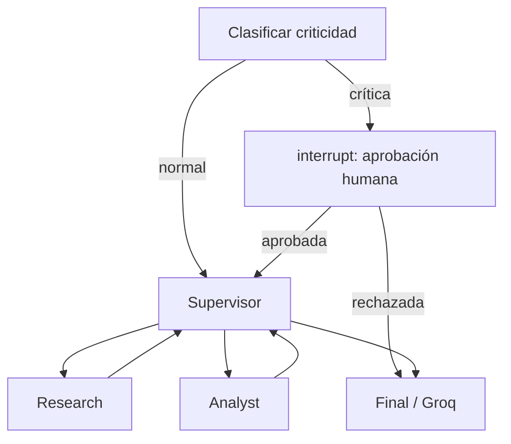

# IA-Entrega-7 — API FastAPI multiagente con Redis, HITL y trazas

API REST asíncrona que lleva el orquestador jerárquico de la Entrega 6 a un entorno de ejecución durable. Usa exclusivamente **Groq**, con el modelo `openai/gpt-oss-120b`; no hay ningún proveedor OpenAI en el código.

## Qué implementa

- `POST /tasks` guarda el trabajo en Redis, lo encola y responde `202` con `job_id` sin esperar al LLM.
- Un worker `asyncio` consume la cola Redis y actualiza el trabajo: `PENDING` → `RUNNING` → `DONE`, `FAILED` o `WAITING_APPROVAL`.
- LangGraph persiste los checkpoints en Redis mediante `AsyncRedisSaver`; el `thread_id` es el mismo `job_id`.
- El grafo conserva el patrón de la Entrega 6: supervisor, investigación, análisis y síntesis final.
- Las tareas con posibles efectos secundarios pasan por el nodo `human_approval`, que ejecuta `interrupt()` hasta el endpoint de aprobación.
- Los nodos se instrumentan como spans de LangSmith. Con una clave válida, LangSmith registra las llamadas de Groq y calcula tokens, costos y latencias.



## Requisitos

- Python 3.12 o superior
- Docker Desktop (recomendado, para Redis)
- Una clave de Groq
- Una clave de LangSmith para la evidencia de observabilidad

## Inicio rápido con Docker

```powershell
Copy-Item .env.example .env
# Editar .env y completar GROQ_API_KEY y LANGSMITH_API_KEY
docker compose up --build
```

La API queda disponible en `http://localhost:8000` y su documentación interactiva en `http://localhost:8000/docs`.

## Inicio local

En una terminal, iniciar Redis:

```powershell
docker compose up redis -d
```

En otra terminal:

```powershell
py -3.12 -m venv .venv
.\.venv\Scripts\Activate.ps1
pip install -r requirements.txt
Copy-Item .env.example .env
# Para ejecución local, en .env usar REDIS_URL=redis://localhost:6379/0
uvicorn app.main:app --reload
```

## Uso de la API

Enviar un trabajo no crítico:

```powershell
$job = Invoke-RestMethod -Method Post -Uri http://localhost:8000/tasks -ContentType application/json -Body '{"task":"Calculá 24 * 7 y explicá el resultado"}'
$job
Invoke-RestMethod http://localhost:8000/tasks/$($job.job_id)
```

Una tarea que incluya `publicar`, `enviar`, `borrar`, `pagar`, `comprar`, `transferir`, `producción` o `desplegar` se pausa en `WAITING_APPROVAL`:

```powershell
$job = Invoke-RestMethod -Method Post -Uri http://localhost:8000/tasks -ContentType application/json -Body '{"task":"Publicar el informe en producción"}'
# Consultar hasta que status sea WAITING_APPROVAL y aprobarla:
Invoke-RestMethod -Method Post -Uri "http://localhost:8000/tasks/$($job.job_id)/approve" -ContentType application/json -Body '{"approved":true,"reviewer_note":"Revisado por el equipo"}'
```

Si se envía `{"approved": false}`, el grafo se reanuda, registra el rechazo y termina sin invocar agentes que produzcan efectos secundarios.

## Prueba de carga requerida: cinco solicitudes concurrentes

Con la API ya levantada y `LANGSMITH_TRACING=true`:

```powershell
python scripts/load_test.py
```

El script realiza exactamente cinco `POST /tasks` concurrentes e imprime sus `job_id`. Esperá a que todos estén `DONE`, abrí el proyecto definido por `LANGSMITH_PROJECT` en LangSmith, filtrá por el intervalo de esa corrida y guardá capturas reales de:

1. Las trazas y sus nodos.
2. La métrica **cost per run** y la latencia **p95** de esas cinco ejecuciones.

La carpeta [`screenshots/`](screenshots/README.md) no trae imágenes de ejemplo precisamente para no falsear la evidencia. La captura requiere credenciales válidas de Groq y LangSmith y una ejecución real.

## Tests

```powershell
pytest -q
```

Los tests no llaman a Groq ni requieren red. Antes de entregar, además se recomienda verificar desde otra carpeta:

```powershell
git clone https://github.com/juanpr165/IA-Entrega-7.git IA-Entrega-7-clone
cd IA-Entrega-7-clone
docker compose config
```

## Estructura

```text
app/
  main.py           FastAPI y endpoints
  worker.py         cola Redis y worker async
  store.py          estado persistente de jobs
  graph.py          LangGraph + AsyncRedisSaver
  hitl.py           clasificación de tareas críticas
  observability.py  spans LangSmith
scripts/load_test.py cinco solicitudes concurrentes
tests/              pruebas sin API externa
screenshots/        destino de evidencia real
```

## Notas operativas

- Redis guarda tanto el estado de los jobs como los checkpoints de LangGraph. Si se reinicia la API, la metadata y los checkpoints sobreviven mientras Redis conserve su volumen/base.
- El worker mostrado corre en el mismo proceso como implementación simple para la entrega. Para escalar horizontalmente se puede ejecutar el mismo consumidor como proceso separado, conservando la cola Redis.
- La latencia y el costo de LangSmith dependen de la telemetría de una ejecución real; no se declaran números en este repositorio.
